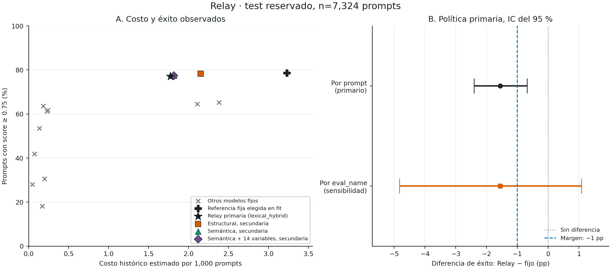
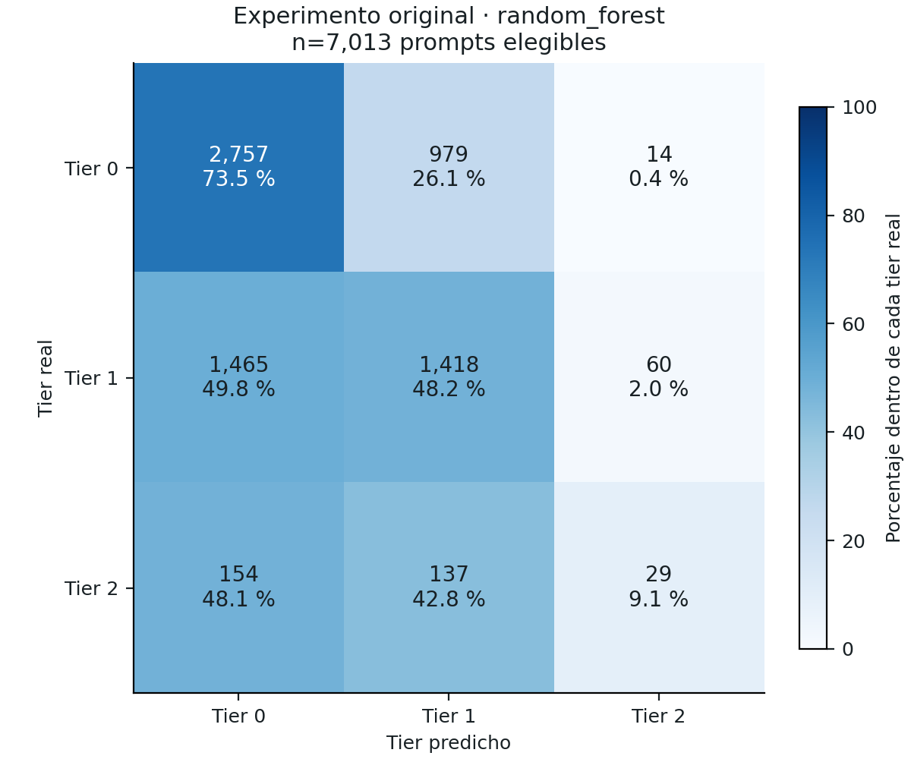

Relay · Resultados finales del estudio offline. Protocolo relay-final-v1. Fecha de referencia: 2026-11-08.

La política primaria fue lexical_hybrid con probabilidad mínima 0.75, elegida únicamente con desarrollo y congelada antes del test. Las variantes secundarias se conservan como comparaciones descriptivas y no reemplazan a la primaria según sus resultados de test.

La selección directa se evaluó sobre 7,324 prompts deduplicados del test, incluidos los que no tienen ningún modelo que alcance el umbral. Éxito significa que el score guardado del modelo seleccionado fue al menos 0.75. La referencia fija gpt-4-1106-preview fue elegida con el subconjunto de ajuste, no con test.

| Política congelada | Éxito | Costo histórico / 1,000 prompts |
| --- | ---: | ---: |
| Referencia fija: gpt-4-1106-preview | 78.62 % | 3.229289 |
| Relay primaria (lexical_hybrid) | 77.06 % | 1.771951 |
| Estructural, secundaria | 78.29 % | 2.151545 |
| Semántica, secundaria | 77.47 % | 1.817267 |
| Semántica + 14 variables, secundaria | 77.43 % | 1.814765 |

Para la primaria, la diferencia de éxito respecto al fijo fue -1.56 pp, IC del 95 % por bootstrap pareado por prompt [-2.40 pp, -0.68 pp]. La reducción relativa del costo histórico de las llamadas fue 45.13 %; su intervalo fue [44.16 %, 46.12 %]. No se incluyeron cómputo del router, entrenamiento, reintentos ni tarifas actuales de proveedores. Este resultado no representa ahorro neto en producción.

El margen de pérdida admisible fue 1 punto(s) porcentual(es), fijado como decisión operativa antes de consultar test. El criterio de calidad exigía que el límite inferior del IC de la diferencia superara −1 pp; el de costo exigía que el límite superior de su diferencia estuviera por debajo de cero. Calidad dentro del margen respaldada: no. Menor costo histórico respaldado: sí. Ambos criterios primarios cumplidos: no. Estado de calidad reportado: inconclusive. No satisfacer no inferioridad no permite afirmar calidad equivalente.

La sensibilidad secundaria agrupada por eval_name produjo un IC de diferencia de éxito [-4.83 pp, +1.08 pp] y de costo por 1,000 [-2.295688, -0.520426], usando 86 grupos. Los intervalos por prompt y por grupo describen unidades de remuestreo distintas. Los nombres de evaluación no necesariamente equivalen a familias independientes. Las comparaciones secundarias no tienen ajuste de multiplicidad y no justifican elegir un nuevo ganador después del test.

El experimento original de tres tiers se reporta por separado sobre 7,013 prompts elegibles. Se excluyeron 311 casos sin etiqueta de tier; esos casos sí permanecen en la evaluación de política directa. La selección original por F1-macro en validación cruzada fue random_forest, sin selección con test.

| Modelo original | F1-macro CV (train) | F1-macro test | Recall Tier 2 test | F1 Tier 2 test |
| --- | ---: | ---: | ---: | ---: |
| dummy | 0.2308 | 0.2323 | 0.00 % | 0.0000 |
| length | 0.3860 | 0.3831 | 24.69 % | 0.1174 |
| logistic | 0.3892 | 0.3954 | 51.25 % | 0.1417 |
| random_forest (seleccionado) | 0.4464 | 0.4445 | 9.06 % | 0.1371 |

P1 queda respondida por la comparación de los modelos tabulares con las referencias: el seleccionado obtuvo F1-macro 0.4445. Su recall de Tier 2 fue 9.06 %; por tanto, la métrica agregada no oculta aquí que una fracción importante de Tier 2 no se recuperó. No se sustituye por el modelo con mayor recall observado después de evaluar test. La desviación entre folds es variabilidad descriptiva de folds correlacionados y no un intervalo de confianza de población.

P2 usa importancia por permutación calculada solo dentro del train, con 3 folds y 5 repeticiones por fold. Los tres atributos del ranking y su estabilidad son:

| Atributo P2 | Caída media de F1 Tier 2 | SD descriptiva | Fracción de folds en top 3 |
| --- | ---: | ---: | ---: |
| uppercase_ratio | 0.0639 | 0.0219 | 100.00 % |
| n_words | 0.0262 | 0.0216 | 100.00 % |
| n_code_markers | 0.0123 | 0.0135 | 33.33 % |

La caída mide dependencia predictiva del modelo, no un efecto causal ni una dificultad intrínseca del prompt. La SD y la frecuencia top 3 no son intervalos de confianza ni probabilidades de que un atributo sea importante; un tercer puesto inestable se presenta como tal.

P3 del experimento original se ejecutó con el clasificador ya congelado y representantes elegidos solo con train: T0: WizardLM/WizardLM-13B-V1.2; T1: zero-one-ai/Yi-34B-Chat; T2: gpt-4-1106-preview. Las rutas se persistieron antes de consultar scores y costos de test. Acierto de tier y éxito del representante son resultados diferentes. [Manifiesto P3](../final-tier-policy-v1/summary.json).

| Política original | Éxito en todo el test | Costo histórico / 1,000 |
| --- | ---: | ---: |
| Clasificador de tiers | 55.07 % | 0.162134 |
| Premium fijo | 78.62 % | 3.229289 |

Frente al Premium fijo, la política original tuvo una diferencia de éxito de -23.55 pp, IC del 95 % [-24.82 pp, -22.28 pp], y reducción relativa de costo histórico de 94.98 %. El oracle del manifiesto es una cota retrospectiva que usa resultados observados y se abstiene sin costo de llamada cuando ningún modelo alcanza el umbral; no es una política desplegable ni una referencia justa de costo operativo.

| Umbral de score para evaluar las mismas llamadas | Éxito de política original | Costo histórico / 1,000 |
| --- | ---: | ---: |
| 0.5 | 58.42 % | 0.162134 |
| 0.75 | 55.07 % | 0.162134 |
| 1.0 | 45.21 % | 0.162134 |

Esta sensibilidad cambia únicamente la definición de éxito: conserva clasificador, representantes y llamadas. No es un estudio reentrenado por umbral. Los balances de etiquetas de train/test y los once modelos fijos están en el manifiesto P3.

Los scores proceden de tareas heterogéneas y un umbral común no necesariamente significa la misma calidad semántica en cada benchmark.

Existe una referencia secundaria adicional en [el manifiesto de RouteLLM BERT](../routellm-bert-secondary-v1/summary.json). Su población, implementación y régimen de entrenamiento deben leerse con ese manifiesto. Se mantiene separada de la comparación primaria de once candidatos; su existencia no acredita una reproducción completa del artículo ni superioridad universal de Relay.

| Métrica/política de la referencia secundaria | Éxito reportado | Costo histórico / 1,000 reportado |
| --- | ---: | ---: |
| RouteLLM BERT | 78.45 % | 3.070635 |
| Relay con el par común | 78.65 % | 3.137186 |
| GPT-4 fijo | 78.62 % | 3.229289 |
| Mixtral fijo | 53.51 % | 0.132834 |

Relay frente a BERT obtuvo una diferencia de éxito de +0.19 pp, IC del 95 % [-0.01 pp, +0.40 pp]; el intervalo incluye cero. Su costo histórico fue 2.17 % mayor. Esta referencia no demuestra superioridad de Relay. Ambos umbrales se seleccionaron únicamente con validación. La comparación conserva el par GPT-4/Mixtral; Relay recibió ajuste local y BERT supervisión externa, con posible contaminación de benchmarks sin resolver. BERT truncó 39 de 7324 prompts al límite oficial de 512 tokens, reteniendo 99.72 % de los tokens. No se evalúa aquí la variante MF ni se aísla el efecto del método bajo supervisión idéntica.

La demo con modelos locales muestra una respuesta generada realmente por el modelo elegido. Su proyección desde grupos históricos a otro catálogo sigue sin validación específica de calidad y costo. Estos resultados de RouterBench no son resultados de esos modelos locales y no acreditan preparación para producción. Ahorrar dinero y consumir menos tokens son resultados distintos.

Siguen pendientes el reentrenamiento por otros umbrales y una evaluación con familias completas fuera del entrenamiento. La sensibilidad de llamadas congeladas de P3 tiene un alcance más limitado. La limitación de preentrenamiento del encoder y la comparabilidad de scores se conservan. El resultado más favorable de una variante secundaria no se transforma en conclusión primaria.

Figura 1. Puntos observados sobre el mismo test, conservando todas las políticas predeclaradas y los once modelos fijos. La estrella identifica la primaria elegida antes del test. El panel derecho muestra IC del 95 % de la diferencia, con 5,000 réplicas pareadas y semilla 42; el remuestreo por eval_name es una sensibilidad secundaria. No se trazan curvas ni interpolaciones entre puntos aislados.

Figura 2. Cada celda conserva el conteo bruto y su porcentaje dentro de la fila de tier real. El color normaliza por fila para comparar clases con distinto soporte. Las fuentes numéricas y la procedencia están en [figure_data.json](figures/figure_data.json) y [provenance.json](figures/provenance.json).

Fuentes locales: [políticas directas](summary.json), [experimento original de tiers](../final-tiers/summary.json), [protocolo congelado](../../configs/final_protocol.json). Los hashes de los archivos fuente y las transformaciones gráficas quedan en el manifiesto de este informe.

Procedencia de herramientas: las guías de integridad y exportación de la skill scientific-visualization se utilizaron para estas figuras. Referencia verificada: Timothy Kassis, Vinayak Agarwal, Yuhuan He, Darshil Patel y Aubrey M. Brueckner (2026), Scientific Agent Skills: A Library of Procedural Knowledge for Research Agents, [doi:10.48550/arXiv.2609.00065](https://doi.org/10.48550/arXiv.2609.00065). Esta cita documenta la herramienta y no respalda las métricas de Relay.
